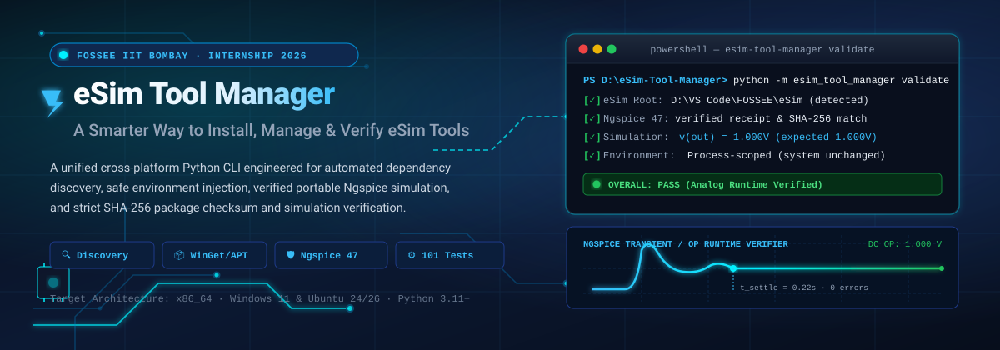
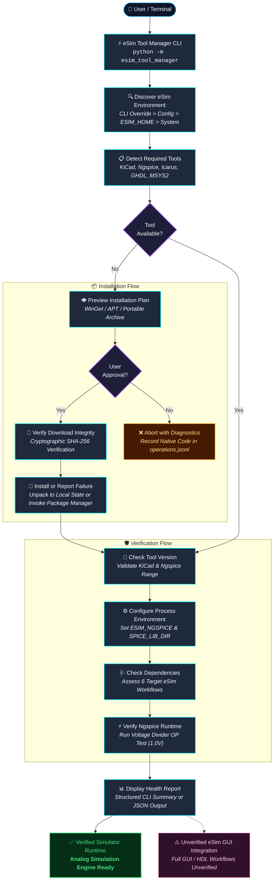

# ⚡ eSim Automated Tool Manager

### *A Smarter Way to Install, Manage & Verify eSim Tools*

<p align="center">
  
</p>

<p align="center">
  <a href="https://www.python.org/"></a>
  <a href="https://github.com/Prasanna-cyber77/eSim-Tool-Manager"></a>
  <a href="https://ngspice.sourceforge.io/"></a>
  <a href="docs/TESTING.md"></a>
  <a href="https://fossee.in/"></a>
</p>

---

The **eSim Automated Tool Manager** is a cross-platform command-line tool built to install, detect, configure, update, and verify software dependencies required by **eSim**. It ensures simulation tools, schema designers, and hardware description backends run reliably and securely without destabilizing host configurations.

---

## 💎 Core Concept

* **The Problem:** Manually discovering, installing, and configuring third-party dependencies for eSim (such as KiCad, Ngspice, and HDL toolchains) is error-prone, platform-dependent, and frequently broken by path mismatches, missing libraries, or corrupted packages.
* **The Solution:** A unified, lightweight Python CLI that automates eSim root discovery, dependency health checks, cryptographic package verification, process-scoped environment isolation, and runtime simulation validation.

---

## 🚀 Key Features

### 🔍 Smart Tool Detection
* **Automatic Root Discovery:** Scans CLI arguments, saved config, `ESIM_HOME`, working directories, and standard installation trees (`%SystemDrive%\FOSSEE\eSim`).
* **Tool Inventory:** Probes installed executables across system paths, eSim bundles, and managed local directories.
* **Version & Path Audit:** Inspects executable versions, checks path ambiguities, and models Windows launcher precedence.

### 📦 Installation & Updates
* **Managed Portable Ngspice:** Downloads official release archives, checks independent SHA-256 digests, and unpacks safely into user local storage.
* **KiCad Package Planning:** Generates actionable WinGet (Windows) and APT (Ubuntu) installation plans.
* **Dry-Run & Previews:** Displays exact URLs, digests, and commands before performing any write action.
* **Integrity Guard:** Refuses corrupted archives or package digest mismatches with structured failure diagnostics.

### 🛡️ Health & Verification
* **Workflow Dependency Matrix:** Assesses prerequisites across 6 distinct eSim workflows (Netlisting, Analog Simulation, HDL Verifier, Icarus Co-simulation, NgVeri, and NGHDL).
* **Real Simulation Verification:** Runs an isolated DC operating point voltage-divider test on Ngspice and verifies expected numeric outputs ($V_{\text{out}} = 1.0\,\text{V}$).
* **Cryptographic Receipts:** Generates signed, tamper-resistant verification receipts bound to binary SHA-256 and simulation metrics.

### ⚙️ Environment Management
* **Process-Scoped Isolation:** Previews and applies simulator variables (`ESIM_NGSPICE`, `SPICE_LIB_DIR`, `PATH`) strictly to child processes.
* **Zero Host Mutation:** Never modifies system registry, machine `PATH`, or global environment variables.
* **Shell Activation Snippets:** Emits copy-paste activation scripts for PowerShell, Command Prompt, and Bash.

---

## 🔄 How It Works



---

## 🛠️ Technology Stack

| Technology | Role | Purpose in Project |
| :--- | :--- | :--- |
| **Python** | Runtime Engine | Core application logic (tested on Python 3.11+) |
| **argparse** | CLI Parser | Structured CLI subcommands, input arguments, and help flags |
| **unittest** | Testing Framework | Comprehensive automated test suite with isolated mocking |
| **py7zr** | Compression | Safe extraction of upstream `.7z` portable Ngspice archives |
| **WinGet** | Windows Packaging | Automated preview and machine-scope installation of system KiCad |
| **APT** | Linux Packaging | Ubuntu/Debian package management, dpkg inspection, and updates |
| **Ngspice** | Circuit Simulator | Official console simulator (v47) and voltage-divider runtime validation |
| **JSON / JSONL** | Data & Logging | Machine-readable outputs (`--json`), settings, and tamper-resistant receipts |

---

## 📦 Installation & Usage

### Setup

```powershell
# Clone the repository
git clone https://github.com/Prasanna-cyber77/eSim-Tool-Manager.git
cd eSim-Tool-Manager

# Create and activate virtual environment
python -m venv .venv

# Install dependencies
.\.venv\Scripts\python.exe -m pip install -r requirements.txt
```

### Essential Commands

```powershell
# 1. Discover eSim root and list detected toolchain versions
python -m esim_tool_manager list

# 2. Check dependency health across 6 eSim workflows
python -m esim_tool_manager doctor

# 3. Verify Ngspice runtime with an isolated simulation test
python -m esim_tool_manager verify ngspice

# 4. Perform complete end-to-end detection and simulation validation
python -m esim_tool_manager validate

# 5. Check for available package and portable updates
python -m esim_tool_manager updates

# 6. Preview portable Ngspice installation (safe dry-run)
python -m esim_tool_manager install ngspice --dry-run
```

---

## 🧪 Testing & Verification

All automated tests and verification routines run against isolated temporary workspaces:

* **102 tests executed**: **101 passed**, **1 skipped** by default.
* **102 passed (100%)** when `ESIM_TOOL_MANAGER_REAL_TESTS=1` is set to run the live managed Ngspice integration test.
* **Real Ngspice 47 verification passed**: Executes an isolated DC operating point simulation and validates the output voltage ($V_{\text{out}} = 1.0\,\text{V}$).
* **Non-destructive demo passed**: `.\scripts\demo.ps1` runs all read-only checks, environment projections, and test suites with exit code 0.

To run the complete test suite:

```powershell
.\.venv\Scripts\python.exe -m unittest discover -s tests -v
```

---

## 📚 Documentation

Detailed architectural notes, verification guides, and submission evidence:

* [Architecture Report](docs/ARCHITECTURE_REPORT.md) — Technical review, design patterns, and engineering decisions
* [Testing Guide & Evidence](docs/TESTING.md) — Automated test logs, receipts, and live validation output
* [Installation Guide](docs/INSTALLATION.md) — Step-by-step setup and platform prerequisites
* [Compatibility Matrix](docs/COMPATIBILITY_MATRIX.md) — Detailed boundaries between verified and diagnostic workflows
* [Final Readiness Report](docs/FINAL_READINESS_REPORT.md) — Screening task completion and verification status
* [Architecture Reference](docs/ARCHITECTURE.md) — In-depth component discovery and precedence specification
* [Troubleshooting Guide](docs/TROUBLESHOOTING.md) — Recovery procedures for common environment and package errors

---

## ⚠️ Known Limitations & Boundaries

* **KiCad WinGet Hash Mismatch**: Upstream WinGet manifests occasionally experience installer SHA-256 mismatches (`0x8A150011`). The manager safely detects and aborts rather than executing untrusted installers; use `diagnose kicad` to review error logs.
* **Simulation Scope vs. Full GUI**: The manager validates standalone console simulation runtimes (`ngspice_con.exe`). Co-simulation (`d_cosim`), NGHDL, NgVeri, and the full eSim GUI workflow remain unverified until executed within eSim itself.
* **Ubuntu Live Runtime**: Debian/Ubuntu package workflows and version checks are modeled and tested with mock fixtures; live execution in an Ubuntu virtual machine is scheduled for subsequent validation rounds.

---

## 📄 Copyright

Copyright © 2026 **Prasanna Mate**.  
Developed for the **FOSSEE IIT Bombay Winter Internship 2026** screening task. All rights reserved.

---

<p align="center">
  <b>Built with precision for the FOSSEE open-source engineering ecosystem.</b>
</p>
